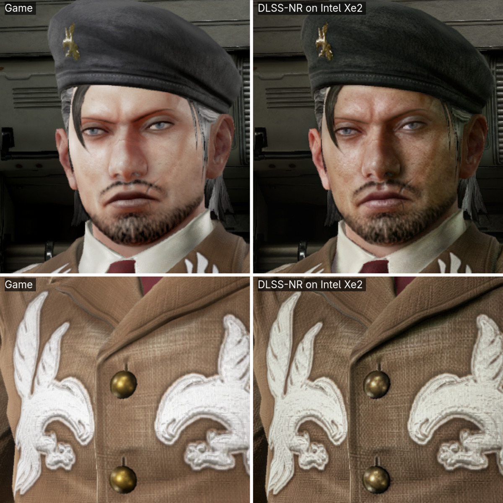
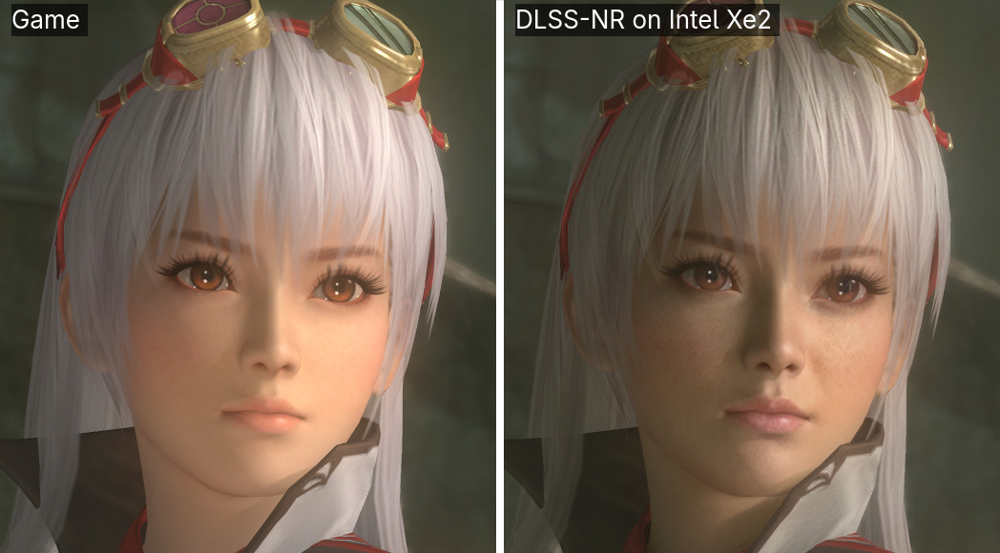
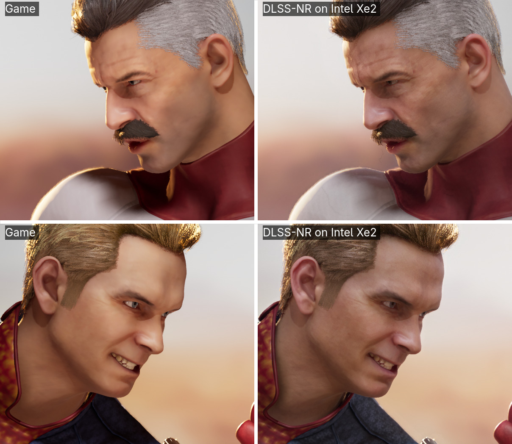

# DLSS 5 Neural Rendering on Intel Arc

NVIDIA's DLSS 5 Neural Rendering, the AI pass that redraws a frame's fine detail, running on
**Intel Arc** graphics, on Windows and Linux. No NVIDIA hardware involved.

It is an **experimental mod**. NVIDIA's network runs on Intel's XMX engines beside the game, so
NR costs frame rate instead of adding it. It does not come with NVIDIA's files: you bring
`nvngx_dlssnr.dll` from a game you own.

## What it looks like

The game's own frame on the left, or on top; the same frame through NR on the right, or below.

NR does not treat every game alike. In Tekken 7 and Dead or Alive 5 the characters come out
darker and with more texture; Mortal Kombat 1's already detailed faces lose its warm colour grade
instead. Whether that is better is taste. More stills, measured:
[docs/DEVS.md](docs/DEVS.md#what-it-looks-like-measured).

Tekken 7 © Bandai Namco Entertainment. Dead or Alive 5 Last Round © Koei Tecmo Games.
Mortal Kombat 1 © Warner Bros. Entertainment Inc.; its guest characters belong to their
respective owners. Shown for comparison.

## Will it run on my PC?

| GPU | |
| --- | --- |
| Intel Arc 140V (Core Ultra 200V, Lunar Lake) | **Yes**: developed and tested on it |
| Intel Arc B570, B580 (Battlemage) | **Yes**, from players' reports; a B580 is the fastest GPU measured so far |
| Intel Arc Pro B-series (Battlemage) | **Should**: a Pro B70's GPU report says NR runs there; not yet tried in a game |
| Intel Arc A-series (A310 to A770, Alchemist) | **Experimental**: it computes correctly on all eleven cards reported so far (A380, A750, A770); an A770 reaches about 40 fps at 1280x720, with render scale 0.4 and network B |
| Intel graphics without XMX engines | **No**: NR runs on XMX |

Not sure? `nr_gpu_probe.exe`, in the release, says whether NR runs on your GPU and writes
`nr-gpu-report.txt`. On an Arc A-series card, please post that file with the
[Arc A-series report](https://github.com/Uzbekunknown/dlss-nr-on-intel/issues/new/choose) template.

| The game's graphics | Windows | Linux |
| --- | --- | --- |
| Vulkan | yes | yes |
| DirectX 8 to 11, 64- or 32-bit | yes, through DXVK, which setup installs | yes, through Proton |
| DirectX 12 | games with **Intel XeSS**: choose XeSS as the upscaler | yes, through Proton |

On Windows a Vulkan or DirectX 8–11 game run as administrator, or with UAC turned off, does not
get NR. Anti-cheat may refuse NR's files or count them as tampering: use it in single-player
games, offline.

## Install on Windows

You need:

- the **[latest release](https://github.com/Uzbekunknown/dlss-nr-on-intel/releases/latest)**, which
  brings its own Python: there is nothing else to install for it;
- your own `nvngx_dlssnr.dll`, copied from a game you own that ships DLSS 5 Neural Rendering,
  such as NBA 2K27. Version 310.9.16 or later holds both of NR's networks, A and B; 310.8 holds A.

Then:

1. Extract the release into a folder of its own and keep it there. Run **`NR-Setup.exe`**.
2. Choose your `nvngx_dlssnr.dll`, the game's `.exe` and its graphics API, then press **Check**
   and **Install NR**. The first install also measures NR on your PC, in under a minute.
3. Start the game the way you always do: Steam, Epic, a shortcut. In a DirectX 12 game, choose
   **XeSS** as the upscaler.
4. In the game, **Home** turns NR on and off, and **Insert** opens its panel: render scale,
   network, strength and the rest, changed as you play.
5. To take it out, **Remove NR** puts the game's folder back as it was.

Every button, the speed test, and setup without the window are in
[the release guide](docs/RELEASE-QUICKSTART.md), which is also the README inside the ZIP. On
Linux NR is built from source: [docs/DEVS.md](docs/DEVS.md).

## What to expect

NR runs a large neural network on every frame, on the same GPU as the game.

- **On an Arc 140V, play at 1280x720 or lower, with render scale 0.4 and network B**: about 20
  to 40 fps in the games below. At 1080p and full render scale it manages a few frames a second,
  which is for screenshots.
- **On a desktop Arc B570 or B580** you can play at 1920x1080 with render scale 0.5: about 50 fps
  with network B on a B580.
- **On an Arc A770**, about 40 fps at 1280x720 with render scale 0.4 and network B, much as on an
  Arc 140V, and about 22 at 1920x1080; it pulls ahead only at higher resolutions and render
  scales. An A750's XMX engines measure about two thirds of an A770's.
- **Network B**, NVIDIA's smaller model, is up to twice as fast as A and changes the picture a
  little less. Setup chooses it when your DLL has it.
- The picture is held steady from frame to frame; a little shimmer can remain where things move.

Every setting, and NR's frame times on each GPU: [docs/SETTINGS.md](docs/SETTINGS.md).

## Tested games

Tested here on an Arc 140V, and by players on their own cards. Each row is how it went on that
date; a later release can do better or worse.

| Game | Tested on | How it ran | Result | Checked |
| --- | --- | --- | --- | --- |
| Mortal Kombat 11 | Arc 140V | Windows, DirectX 11 through DXVK, network B | 34-38 fps at 1280x720 and render scale 0.4, about 10 at render scale 1.0 | 2026-11-05 |
| Euro Truck Simulator 2 | Arc A770, a player's report ([#37](https://github.com/Uzbekunknown/dlss-nr-on-intel/issues/37)) | Windows, DirectX 11 through DXVK | 21-22 fps at 1920x1080 and render scale 0.4 with network B; 6 at full render scale | 2026-11-04 |
| Star Wars Battlefront II (2017) | Arc A770, a player's report ([#37](https://github.com/Uzbekunknown/dlss-nr-on-intel/issues/37)) | Windows, DirectX 11 through DXVK | about 22 fps at 1920x1080 and render scale 0.4 with network B, once the player kept the PC's other Vulkan layers out (`VK_LOADER_LAYERS_DISABLE=~implicit~`) | 2026-11-04 |
| Alien: Isolation | Arc A770, a player's report ([#37](https://github.com/Uzbekunknown/dlss-nr-on-intel/issues/37)) | Windows, DirectX 11 through DXVK | 17-18 fps | 2026-11-04 |
| Assetto Corsa | Arc B580, a player's report ([#34](https://github.com/Uzbekunknown/dlss-nr-on-intel/issues/34)) | Windows, DirectX 11 through DXVK | smooth at 1920x1080 with network B and render scale 0.5; 9-15 fps with network A | 2026-11-03 |
| Euro Truck Simulator 2 | Arc A750, a player's report ([#32](https://github.com/Uzbekunknown/dlss-nr-on-intel/issues/32)) | Windows | NR takes 154 ms a frame at 1920x1080 and render scale 0.6, so about 6 fps at most | 2026-11-02 |
| Nuclear Option | Arc A770, a player's report ([#25](https://github.com/Uzbekunknown/dlss-nr-on-intel/issues/25)) | Windows, DirectX 11 through DXVK, or Vulkan | 40 fps at 1280x720 and render scale 0.4 through DirectX 11; 23 through Vulkan, on network A | 2026-11-01 |
| Hogwarts Legacy | Arc 140V | Windows, DirectX 12 through XeSS, network B | about 26 fps at 1280x720 and render scale 0.4, with XeSS frame generation as well | 2026-10-31 |
| Dead or Alive 5 Last Round | Arc 140V | Windows, DirectX 9 (32-bit) through DXVK, network B | about 22 fps | 2026-10-18 |
| DOOM (2016) | Arc B580, a player's report ([#17](https://github.com/Uzbekunknown/dlss-nr-on-intel/issues/17)) | Windows, Vulkan | 73 fps at 1920x1080 and render scale 0.4 with network B, 48 with network A | 2026-10-18 |
| Driving Rogue | Arc B580, a player's report ([#17](https://github.com/Uzbekunknown/dlss-nr-on-intel/issues/17)) | Windows, DirectX 11 through DXVK | 53 fps at 1920x1080 and render scale 0.5 with network B, 34 with network A; at full scale 18 and 10 | 2026-10-18 |
| Batman: Arkham Knight | Arc B570, a player's report ([#19](https://github.com/Uzbekunknown/dlss-nr-on-intel/issues/19)) | Windows, DirectX 11 through DXVK | playable at 2560x1440 and render scale 0.4 | 2026-10-17 |
| Mafia III | Arc B570, a player's report ([#15](https://github.com/Uzbekunknown/dlss-nr-on-intel/issues/15)) | Windows, DirectX 11 through DXVK | about 30 fps at 2560x1440, judged by eye | 2026-10-13 |
| Assassin's Creed Unity | Arc B570, a player's report ([#15](https://github.com/Uzbekunknown/dlss-nr-on-intel/issues/15)) | Windows, DirectX 11 through DXVK | works | 2026-10-13 |
| Tekken 7 | Arc 140V | Linux, DirectX 11 through Proton, network A | 30 fps at 800x450 and render scale 0.35 | 2026-09-27 |
| Mortal Kombat 1 | Arc 140V | Linux, DirectX 12 through Proton, network A | works; at full render scale it ran out of memory beside the game | 2026-09-16 |

Tried another game? Tell us how it went, with the file **Save report** writes:
[open an issue](https://github.com/Uzbekunknown/dlss-nr-on-intel/issues/new/choose).

## If it does not work

- **Nothing changes.** Check that NR is on: **Home** in the game, or **Enable NR** in the setup
  window. A DirectX 12 game must use XeSS as its upscaler. In a Vulkan game NR is only in the
  `.exe` you chose; **Check** names the one that draws with Vulkan (DOOM 2016: `DOOMx64vk.exe`).
- **It is very slow.** Lower the game's resolution first, then the render scale, and use network B.
- **It stopped after a game update.** **Remove NR**, then **Install NR** again.
- **The game closes while loading.** The GPU shares the PC's memory: close other programs and
  lower the render scale.
- **Still stuck?** Press **Save report** in the setup window and attach the file to an
  [issue](https://github.com/Uzbekunknown/dlss-nr-on-intel/issues/new/choose).

## How this was built

**This project was written by AI agents**: Claude Opus 5 and 5.5, and ChatGPT Astra and Sol in a
parallel tree, under the author's direction. All breakdowns and analysis are written by AI. What that means,
and the evidence offered instead of a line-by-line defence:
[docs/DEVS.md](docs/DEVS.md#how-this-was-built).

## More

- [docs/DEVS.md](docs/DEVS.md): building and running from source, Linux, the control tools, tests.
- [docs/SETTINGS.md](docs/SETTINGS.md): every setting, and measured frame times.
- [docs/ARCHITECTURE.md](docs/ARCHITECTURE.md): the recovered network, for running it elsewhere.
- [notes/INDEX.md](notes/INDEX.md): what was measured, the wrong turns included.

## Credits and licences

**Apache License 2.0**: [LICENSE](LICENSE) and [NOTICE](NOTICE).

- [MLX-DLSS](https://github.com/iamwavecut/MLX-DLSS) (Apache-2.0) recovered the network's graph
  from vendor captures, and its tools extract the weights.
- [OpenDLSS-NR](https://github.com/maanHimself/OpenDLSS-NR) (MIT): where that graph and the
  vendor's differ, this port follows it, checked block by block (`notes/opendlss-reference.md`).
- [DLSSNR-AMD](https://github.com/mochizuki0323/DLSSNR-AMD) (MIT): the cut in the game's DirectX 12
  command list that NR's XeSS path is built on.
- [Dear ImGui](https://github.com/ocornut/imgui) (MIT) draws the panel in the game, which
  Paimonshen contributed ([#20](https://github.com/Uzbekunknown/dlss-nr-on-intel/pull/20)).
- [DXVK](https://github.com/doitsujin/dxvk) 3.1.1 (zlib) ships with the Windows release, for
  DirectX 8–11 games.
- [andyvand/dlss-nr-on-vulkan](https://github.com/andyvand/dlss-nr-on-vulkan) (Apache-2.0): the
  CMake build and extra GEMM checks.

DLSS, Neural Rendering and `nvngx_dlssnr.dll` are NVIDIA Corporation's. This is an independent
reimplementation of the inference pass, not affiliated with or endorsed by NVIDIA, and it
contains no NVIDIA code. **No weights and no NVIDIA binary are distributed here.**
