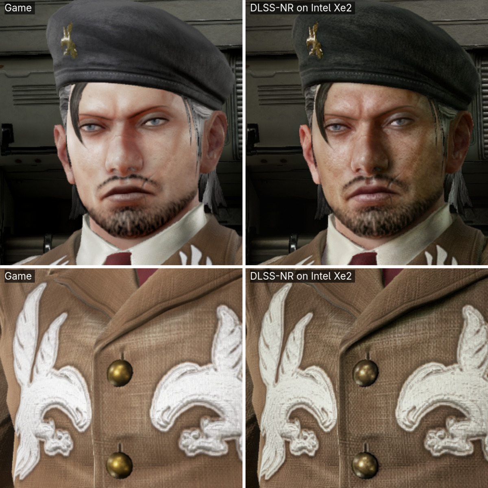
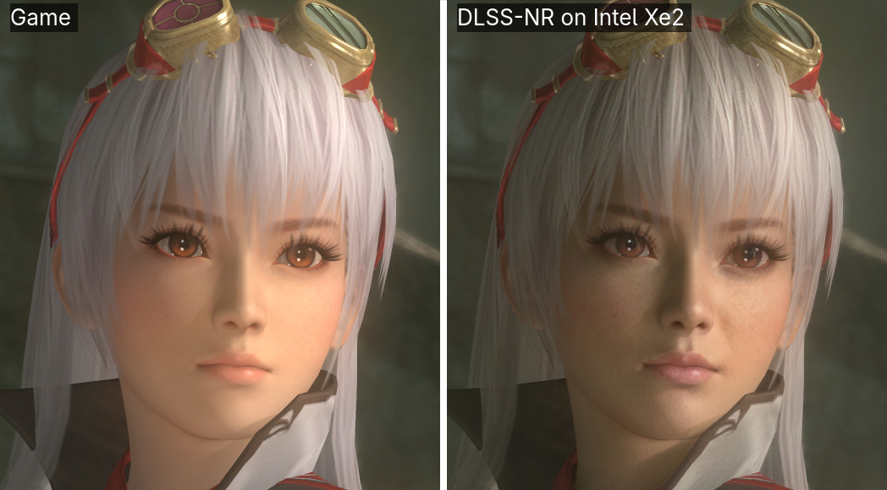
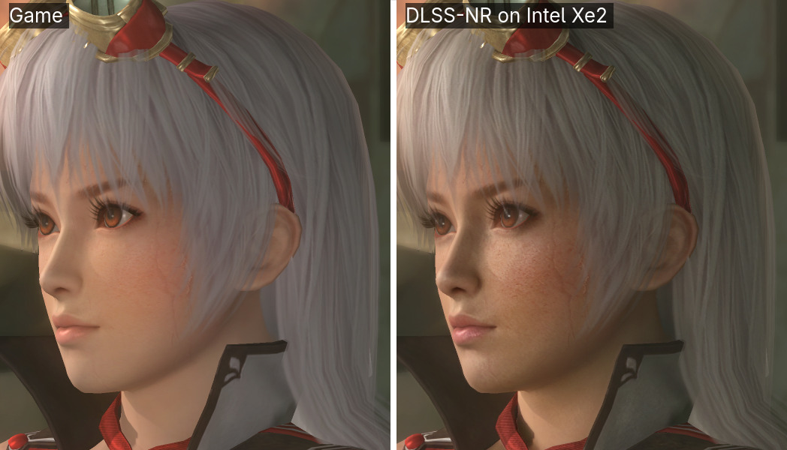
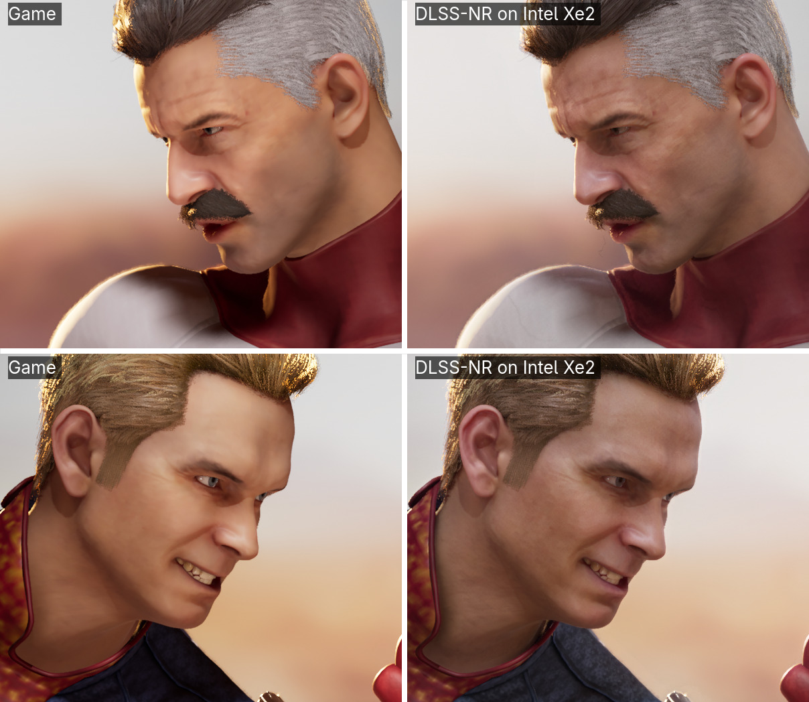
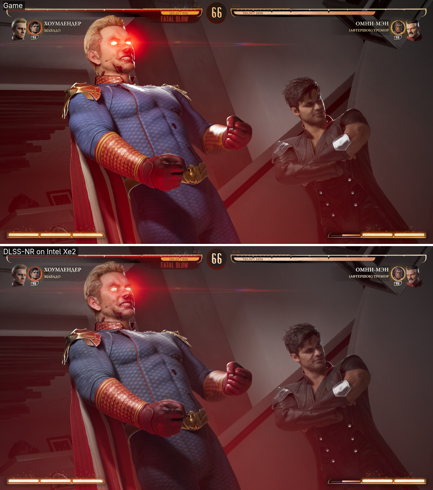

# For developers

The [README](../README.md) is for players, and the Windows release needs nothing on this page.
This is for building and running NR from source, which is how it runs on Linux: what you need,
the build, the layer and the daemon, the control tools, the tests and the repository's layout.
Every setting, with its measured cost, is in [SETTINGS.md](SETTINGS.md), and the recovered network
itself in [ARCHITECTURE.md](ARCHITECTURE.md).

## How this was built

**This project was written by AI agents.** The author supplied the machine, the binary and
the direction, and made the decisions; the code, the measurements and the notes were
produced by **Claude Opus 5 and 5.5** and, in a parallel tree, by **ChatGPT Astra and Sol**;
Astra's work on the native host passes was taken into this one (`src/ref/nr_image.c`,
`notes/phase57`).

That is stated here rather than left to be noticed, because it changes how you should read
everything else. What it means in practice:

- **Nothing is asserted that was not measured.** Every number in the notes has a program
  behind it in `src/bench/`, and `make test` is about 570 checks, including the native
  passes against the NumPy they replace byte for byte.
- **The wrong turns are in the notes too**, deliberately. A hypothesis about shared-memory
  bank conflicts that measured 1.11x instead of the textbook 32x. A "driver bug" that
  shaped three phases and does not exist. A profile recommended from one frame and
  withdrawn after the next. Several notes say at the top that they are superseded.
- **The author does not claim to be able to defend the code line by line.** What is
  offered instead is the evidence: the tests, the benchmarks, and the record of how each
  conclusion was reached — including the ones that were wrong.

Judge it on that. If something here is wrong, the measurement that would show it is
probably already in `src/bench/`.

## Windows and Linux

The pass is the same on both: the same weights, the same graph and the same ten settings,
and since 2026-10-01 Intel's Windows driver and Mesa compute the graph bit for bit alike
(`notes/phase71-intel-windows-driver.md`). What differs is everything around it:

| | Windows | Linux |
| --- | --- | --- |
| Install | the release ZIP and its setup window, in English, Chinese, Russian or Spanish | built from source with `make` or CMake |
| GPU driver | Intel's own | Mesa ANV |
| Games | native Vulkan, and DirectX 8–11 through the DXVK 3.1.1 that setup puts beside the game, 64- and 32-bit; **DirectX 12 through the game's own XeSS**, NR on XeSS's output (Hogwarts Legacy so far) | whatever Proton runs, since DXVK and VKD3D-Proton come with it: DirectX 12 too (Mortal Kombat 1) |
| Starting the game | any way at all — Steam, a shortcut, another launcher: setup puts a `vulkan-1.dll` beside the game that gives it NR | with NR's environment: the Steam launch option `nr-photo --steam` prints, or `nr-photo` itself |
| Controls | the panel in the game (Insert opens it, Home turns NR on and off), and the setup window's NR controls | `nr-panel`, `nr-ctl`, and `nr-toggle` on a key |
| Modes | live | live, and the photo mode |
| Taking it out | **Remove NR** puts the game's folder back as it was | remove the launch option |

The network runs slower on Intel's Windows compiler at large frames — about 170 ms against
140 at 1344x768 — and as fast at the live sizes, about 24 ms at 320x320 on both
(`src/bench/frame_replay.py`). Around the network the two are level.

## What you need

- An Intel **Xe2** GPU: `VK_KHR_cooperative_matrix` with an `fp16 x fp16 -> fp32`
  configuration of **M=8, N=16, K=16**, which every XMX kernel here is written for.
  Developed and measured on **Arc 140V (Lunar Lake), Mesa ANV**; an Arc B580 (discrete
  Battlemage) reports the same six configurations. **Arc A-series (Alchemist, Xe-HPG) is
  experimental**: its matrix units offer 8x8x16 only, so these kernels run there on a shape the
  hardware does not offer. Six A770s computed it exactly (issues #22 to #26 and #28), and one
  A750 ran at 1-2 fps (#18). A Vulkan device alone is not enough, and the GPU report, which says whether these kernels run
  and measures what the matrix units do, needs neither weights nor the rest of the build:

  ```sh
  make work/coopmat_probe work/coopmat_bench8.spv work/coopmat_bench16.spv
  work/coopmat_probe      # also writes nr-gpu-report.txt
  ```

  The Windows release carries it as `nr_gpu_probe.exe`. On an A-series card, please post the
  report with the **Arc A-series report** issue template.
- A **discrete** Xe2 card (Battlemage, B570/B580) works too, and does not need resizable BAR: where the card's memory
  cannot be mapped, the graph keeps its operands there anyway and the host reaches them by
  copies. Turn resizable BAR on if you can — it is the faster of the two paths and Arc wants
  it for everything else — but it is no longer the difference between working and crawling.
  This is written from one owner's report and tested by forcing the same path on the
  integrated GPU; it has not been measured on a discrete card.
- On Linux: Python 3 with NumPy, a C compiler, `glslangValidator` and the Vulkan loader. On
  Windows the release needs only a 64-bit Python and your DLL; building it needs MSVC and the
  Vulkan SDK (`tools/build_win.bat`, [docs/WINDOWS.md](WINDOWS.md)). The network's output
  is the same on both, bit for bit.
- **ImageMagick** for the still-frame tools, which read and write pictures through
  `magick`. The game path does not touch it.
- About 0.7 GiB of memory for the device buffers at 720p and 1.3 GiB at 1080p, the weights
  included — it shares system RAM.
- OpenCV is optional and worth having: it is the fast path for the blur that moving
  `detail_strength` or `colour_strength` needs — 32 ms against 110 at 854x480
  (`notes/phase48`). Everything else is the same without it.

## Build

**Windows users** need no build: the release carries everything ([README](../README.md)).
To build it yourself, the [Windows quick start](WINDOWS-QUICKSTART.md) covers the MSVC
build, the first Vulkan launch, the effect toggle and a diagnostic report. The commands below
are the Linux setup.

```sh
mkdir -p work
git clone --depth 1 --branch v1.4.321 \
          https://github.com/KhronosGroup/Vulkan-Headers.git work/vulkan-headers
git clone https://github.com/iamwavecut/MLX-DLSS.git work/mlx-dlss
git -C work/mlx-dlss checkout 06a3e11a8b68817127406ace5c764463543f699b
make
```

Alternatively, after fetching the same dependencies, build with CMake 3.21 or newer:

```sh
cmake -S . -B work/cmake
cmake --build work/cmake -j4
ctest --test-dir work/cmake --output-on-failure
```

This builds the current **Linux/XMX** runtime. It finds Vulkan headers in the SDK,
system paths or `work/vulkan-headers`, and writes artifacts into `work/` so the existing
daemon and launchers can use them. Choose a Python environment with
`-DPython3_EXECUTABLE=/path/to/venv/bin/python`; it needs NumPy and the dependencies above.
Use `-DNR_BUILD_LAYER=OFF` for a compute-only build, or `-DNR_BUILD_TESTS=OFF` to omit tests.
The CMake build and additional GEMM checks are adapted from
[andyvand's fork](https://github.com/andyvand/dlss-nr-on-vulkan); see `NOTICE`.
Its macOS/Windows runtime and C frame library are separate changes, not included here.
Both build the 32-bit layer, `work/libnr_layer32.so`, for 32-bit games, wherever a 32-bit
compiler and a 32-bit Vulkan loader are installed (on Arch, `lib32-glibc`, `lib32-gcc-libs`
and `lib32-vulkan-icd-loader` from multilib). `make LAYER32=0` or `-DNR_BUILD_LAYER32=OFF`
leaves it out. The two build the same shaders with the same flags and register the same tests
— `src/tools/build_check.py` fails the suite when they part. Avoid running both at the same
time because they write the same artifacts.

Then extract the weights from your own DLL (needs `safetensors` as well as NumPy):

```sh
mkdir -p work/mlxw
python3 work/mlx-dlss/python/mlxdlss/tools/extract_dlssnr_weights.py \
        /path/to/nvngx_dlssnr.dll work/mlxw/dlssnr-packed.safetensors
python3 work/mlx-dlss/python/mlxdlss/tools/unpack_dlssnr_weights.py \
        work/mlxw/dlssnr-packed.safetensors work/mlxw/dlssnr-logical.safetensors
```

The result is 649 named tensors, **145 755 123 parameters**: the large matrices are
stored in the DLL as FP8 E4M3, one byte each, and decoded to FP16. The reader checks
`fully_logical=true` and refuses anything else — the packed file is **not** a substitute,
and reading it as dense FP16 gives values correlating -0.02 with the truth.

Network B, NVIDIA's smaller model, comes in `nvngx_dlssnr.dll` 310.9.16 and later. Take it out
of the same DLL, and start the daemon with `NR_PRESET=B` to run it (`notes/phase72-preset-b.md`):

```sh
python3 src/tools/unpack_preset.py /path/to/nvngx_dlssnr.dll work/mlxw/dlssnr-b-logical.safetensors
```

`make` also builds `work/libnr_image.so`: the full-frame passes around the network —
feature assembly, the resizes, the composition, the 8-bit codecs — in C rather than NumPy,
worth about 2.6x on the host side of a frame. It is built for `x86-64-v3` — AVX2 and F16C,
every CPU since Haswell and Zen 1 — and `NR_IMAGE_ARCH` changes that. Everything still works
without it; `NR_HOST_NATIVE=0` selects the NumPy path for a paired measurement.

```sh
make test                                        # about 570 checks, fewer without weights
python3 src/ref/nr_frame.py IN.png OUT.png --resident   # one still, no game
```

Two I/O switches, **both on by default since 2026-09-25**: `NR_INPUT_FP16` builds the
network's input as half, straight into the mapped input buffer, so neither a host copy
nor a GPU conversion pass is left; `NR_COMPACT_HEAD` reads back only the four useful
output channels, a quarter of the bytes. Neither can change a value. Set either to `0`
in the daemon's environment, not only the game's, to compare. On a discrete card the
compact head should matter more, since the read crosses PCIe; B570/B580 results are
still needed. For exact checks and paired benchmarks, see
[the I/O experiment notes](../notes/improve-compact-io.md).

`NR_JOINT_QKV=1` is another optional experiment: it combines preparation of Q, K
and V into one dispatch, removing 140 passes per frame. It is **off by default**:
on 140V at network extent 448x320 it increased warm frame time from 79.1 to 83.2 ms.
See [the QKV experiment and diagnostic notes](../notes/improve-joint-qkv.md) for exact
checks, the paired benchmark and profiling commands for B570/B580.

## Run it in a game

Two processes: a **daemon** that holds the model, and a **Vulkan layer** inside the game
that hands it each frame. They meet over a Unix socket on Linux and a named pipe
on Windows, where the setup window does all of what follows
([release quick start](RELEASE-QUICKSTART.md)).

```sh
python3 src/layer/nr_daemon.py --settings /tmp/nr_settings.json
NR_LIVE=1 src/layer/nr-photo --steam <appid>   # prints the Steam launch option to paste
```

**Generate the launch option on your own machine, in your own clone, and paste what it
prints.** Do not copy one from this page, a forum post or somebody else's screen: it carries
the absolute path to *their* checkout, and on yours that path points at nothing, so the layer
silently never loads. The line looks like this, with your path in place of the placeholder:

```
VK_LAYER_PATH=/path/to/your/clone/work/layer VK_INSTANCE_LAYERS=VK_LAYER_dlssnr_intel ENABLE_NR_LAYER=1 NR_LAYER_SOCKET=/tmp/nr_layer.sock NR_LAYER_TRIGGER=/tmp/nr_trigger NR_LAYER_LIVE=1 %command%
```

`nr-photo` also writes the layer manifests into `work/layer` for you; if you move the clone,
run it again. Leave out `NR_LIVE=1` for photo mode. For a native Vulkan game,
`src/layer/nr-photo <game>` sets the environment itself.

| variable | what it does |
| --- | --- |
| `VK_LAYER_PATH` | where the layer's manifest is — **your** clone's `work/layer` |
| `ENABLE_NR_LAYER=1` | turn the layer on for this process |
| `NR_LAYER_SOCKET` | where the daemon listens. **Required, no default** — without it the layer never contacts the daemon at all. The daemon and the tools use `/tmp/nr_layer.sock` |
| `NR_LAYER_TRIGGER` | the file that means "do it". **Required for the toggle** — without it, live mode captures every frame whether the effect is on or not. The tools use `/tmp/nr_trigger` |
| `NR_LAYER_LIVE=N` | live mode: every Nth present goes through the network |
| `NR_LAYER_ASYNC=1` | with live mode: each processed present shows the answer for the one before it, so the daemon works while the game draws its next frame — more frames a second, one more frame of latency. Off by default; `NR_ASYNC=1 NR_LIVE=1 src/layer/nr-photo --steam <appid>` prints it into the launch option |
| `NR_LAYER_UI_MASK=1` | mark pixels that held still and leave them as the game drew them |
| `NR_LAYER_SYNC` | accepted for old launchers and ignored: there is one synchronisation path, described under **Capture synchronization** below |

**If your frame rate drops as soon as the game starts and the daemon's log shows no frames**,
one of the first four is missing or wrong: the layer is capturing and has nowhere to send it.

### The layer can start the daemon itself

With `NR_LAYER_SPAWN=1` set next to the variables above, and `NR_LAYER_SOCKET` named, the
layer starts the daemon on that socket if nothing is listening there when the game creates
its instance. Without the variable nothing happens and nothing prints, which is the
default: `vulkaninfo` and every other Vulkan process that loads the layer must not each
bring up a model. A daemon started this way
**ends with the game that started it**, on Linux as on Windows: the layer hands it the game's
process id. Steam counts every process a game starts as part of the game, and a daemon that
stayed kept the game running for Steam after it had closed. While it runs it holds its buffers
and the weights, **0.7 GiB at 720p and 1.2 GiB at 1920x1088, weights included**, and it ends
on its own when the GPU is lost; a daemon you start yourself runs until you end it. Its settings and log follow
`src/layer/nr_paths.py` (`/tmp/nr_settings.json`, `NR_LAYER_LOG`), the same files `nr-ctl`
and `nr-panel` write, so the knobs reach a daemon started this way too.

`NR_PYTHON` names the interpreter to start it with, for an install the layer cannot guess
at. On Windows the default is the `py` launcher, not `python3`: that name belongs there to
the Microsoft Store's zero-byte alias, which `CreateProcessA` starts happily and which
then exits without running anything.

Without `NR_LAYER_LIVE` it is a **photo mode**: the pass fires once and holds its result
on screen while the trigger exists. With `NR_LAYER_LIVE=1` every present goes through the
network — 25-30 fps at 640x360 to 800x450 on the Arc 140V, beside the game; with a larger N
the presents between hold the last result.

## The three tools

All three drive the same two files: a trigger, and a JSON settings file the daemon
re-reads whenever it changes. Nothing reloads the model, so every knob below moves
between frames while the game runs.

### `nr-panel` — everything on one screen

```sh
src/layer/nr-panel
```

Arrow keys pick a knob and change it. The bottom of the screen is what the daemon is
actually doing, read from its log rather than estimated: extent, milliseconds, the
history gate, how much of the frame it is holding still. `space` turns the effect on and
off and starts the daemon if it is not up; `d` gives a knob back to the daemon's own
default; `q` leaves, and the game carries on.

It is curses, not a toolkit — nothing outside the standard library, and it works the same
over ssh.

### `nr-ctl` — the same thing, one shot

```sh
src/layer/nr-ctl                       an interactive session
src/layer/nr-ctl on                    start enhancing
src/layer/nr-ctl off                   hand the game back
src/layer/nr-ctl set scale 0.5
src/layer/nr-ctl help colour_strength  what a knob actually does
src/layer/nr-ctl rates                 measured frame times by extent and scale
src/layer/nr-ctl report                everything a bug report needs, in one paste
```

`report` is the one to run when the picture stops changing and you cannot tell why: it
prints the version, whether the daemon is listening, which GPU it took and where its buffers
went, every knob, the last frames with the time split, and — the part nobody thinks to look
for — the frames the daemon **refused**. A frame that fails is invisible while you play: the
game simply shows its own picture.

### `nr-toggle` — on and off, from a key

```sh
src/layer/nr-toggle            flip it
src/layer/nr-toggle temporal   flip the temporal path, to see the flicker it removes
src/layer/nr-toggle install    print the commands and open the key settings
```

Answers with a desktop notification, because a fullscreen game covers a terminal and does
not cover the compositor. Turning it on starts the daemon, so one key really is one key.

**Bind it in your desktop's own settings.** On Wayland an application cannot grab a key
for itself, and this tool used to register a Plasma global shortcut itself — which
crashed the compositor on the first keypress. `notes/phase55` has the backtrace and the
reason; the short version is that in Plasma 6.7 the shortcut registry lives inside KWin,
so anything that edits its config files behind its back is working on a corpse.

## How it works

```
game ──presents──▶ Vulkan layer ──socket──▶ daemon ──▶ 71-block U-Net on XMX
  ▲                                                          │
  └──────────────── the composed frame ◀─────────────────────┘
```

- **The graph** is a symmetric U-Net: five Swin stages at 32/64/128/256/512 channels down
  to a ViT-1D bottleneck and back, 71 blocks, recovered from the DLL's intact RTTI,
  anchored on MLX-DLSS's independent extraction of the same binary, and corrected where it
  and the vendor's differ against OpenDLSS-NR, which claims the vendor's own arithmetic.
  Network B is the same graph at depth 2 in every stage: 31 blocks (`notes/phase72-preset-b.md`).
- **Every GEMM runs on XMX** in FP16 with FP32 accumulate, through cooperative matrix.
  The whole graph is resident: operands travel as 64-bit addresses in push constants, and
  activations never come back to the host.
- **The output is a *head***, not a picture — a residual the composition adds to the
  game's own frame. That is why the render scale can be lowered without resampling the
  game's pixels: only the synthesised part is interpolated.
- **A frame of history** is fed back into the network's own history channels, and the
  model's learned gate decides per pixel how much survives. That is what stops the
  picture shimmering.

**[`docs/ARCHITECTURE.md`](ARCHITECTURE.md) is the recovered network**: the extent
rule, all sixteen input channels, the four-channel head and its composition, the block
table, the weight container and the trap in it, and what agreement with the original is
and is not possible. It is written for someone who wants to run this somewhere else, and
it is the file to read before any of the notes.

`notes/INDEX.md` maps every phase note to the question each one settles, and
several of the answers are counter-intuitive. `notes/HANDOFF.md` is the current state and the
traps.

## Performance work

Inside the graph, the passes themselves are done: GEMM is register-bound, and every pass
that only moves data runs at the machine's memory ceiling. Tiling, operand staging, integer
weights, the accumulator format, OpenCL, shared-memory bank padding and handing work to the
E-cores have all been measured and all are closed (`notes/phase45`, `notes/phase46`). What
did move the graph was deleting passes: a pass at the memory ceiling that need not exist is
all waste. Folding the residuals into the projections, attention into one pass with its
head merge, Q/K normalisation and the window partition into the QKV projection's own
epilogue and loads, the narrow blocks' feed-forward into one kernel and the full-resolution
glue into fewer passes took a 1280x720 frame from 445 to 231 ms at the time, 48 %, with every
output bit-identical
(`notes/improve-fusions.md`, `notes/improve-qkv-epilogue.md`). The other thing that moved it
was shared memory, which decides how many workgroups a core holds: 128 KB between them,
each share rounded up to 1, 2, 4 ... KB. Window attention at 3104 bytes took 4 KB and so half
the core's threads, and at exactly 2 KB is 18 % faster; the staged GEMM at 15.5 KB took 16
and half the threads too (`notes/improve-shared-memory.md`, which also has a driver quirk
that makes some *smaller* declarations slower). With the one-pass window blocks and
bottleneck attention since, a full-scale 1280x720 frame is about 150 ms end to end and the
live sizes 25-27 ms. What bounds the GEMMs now is the register file: Xe2's 256-register mode
can be reached with a small Mesa patch, and with these kernels it is slower
(`notes/improve-large-grf.md`).

## What it looks like, measured

Stills with the model at full resolution. Left, or on top: the game's own frame. Right, or
below: the same frame through DLSS-NR on this Intel Arc 140V.

<sub>Captured on 2026-09-16 and rendered again on 2026-09-28, from the same captured frames,
through the graph as it is now (`src/bench/restill.py`); the images and the table below come
out of `src/tools/comparisons.py`.</sub>

**Tekken 7** — Unreal Engine 4, D3D11, 1920x1080, crops enlarged 2x:



**Dead or Alive 5 Last Round** — D3D9, 1920x1080, a different engine and art style:





**Mortal Kombat 1** — Modified Unreal Engine 4, **D3D12** through VKD3D-Proton, 1600x900:





Measured rather than eyeballed. Texture is the high-frequency energy normalised for the
change in brightness, because on this model the brightness moves and it fools the eye:

| image | region | brightness | relative texture | colour change |
| --- | --- | --- | ---: | ---: |
| Tekken 7 | face | 78 -> 59 | **+28 %** | 22.0 |
| | jacket weave | 90 -> 70 | **+61 %** | 20.9 |
| | embroidery | 135 -> 115 | +43 % | 21.0 |
| | background | 35 -> 34 | -9 % | **4.5** |
| DoA5, close-up | face | 107 -> 93 | +10 % | 17.9 |
| | background | | -24 % | **4.7** |
| DoA5, by the fire | face | 96 -> 84 | +16 % | 15.3 |
| | background, fire | | -4 % | 8.2 |
| Mortal Kombat 1 | Omni-Man's face | 131 -> 131 | **-10 %** | 14.8 |
| | Homelander's face | 131 -> 130 | **-19 %** | 13.8 |
| | the whole fight frame | 56 -> 57 | -2 % | 6.8 |

**The three games do not get the same treatment, and that is the honest summary.** On
Tekken 7 and Dead or Alive 5 the character comes out darker and gains texture — a great deal
on Tekken's fabric, less on Dead or Alive's already-smooth skin — while the background is
left almost alone. On Mortal Kombat 1, whose faces are already rendered in fine detail, the
brightness does not move and the fine detail on the faces goes *down*: what changes is the
colour, with the warm filmic grade and the glow on the skin taken out. That is not film grain
being removed — a flat defocused patch of the same frame has none to remove — but whether
what goes is skin detail or the game's own sharpening has not been measured.

Across all of them, what the pass adds in one place it takes from another. **Whether any of
it is better is taste, not measurement** — it is photographic where the games are stylised.

These are stills. Live — every frame through the network, beside the game on the same
iGPU — **Tekken 7 runs at 30 fps at 800x450** with the render scale at 0.35, and 27 at 0.6
(the author, 2026-09-27).

<sub>Tekken 7 © Bandai Namco Entertainment. Dead or Alive 5 Last Round © Koei Tecmo Games.
Mortal Kombat 1 © Warner Bros. Entertainment Inc.; its guest characters belong to their
respective owners. Shown for comparison.</sub>

## Troubleshooting

**The picture stops changing, and nothing looks broken.** Run `src/layer/nr-ctl report`.
A failing frame does not announce itself — the daemon writes a line and the game keeps its
own picture — so the two things to look at are the refused count and the last frames. Raising
the render scale is the usual cause: the buffers for a large extent may not fit, and then
every frame is refused with `(-2)`.

**"no daemon" / nothing happens.** `src/layer/nr-ctl status` says whether the daemon is
listening and whether the effect is on. They are independent: the trigger can be up with
no daemon, and a daemon can be idle with the trigger down.

**The game runs but the picture never changes.** The layer only attaches with
`ENABLE_NR_LAYER=1` in the *game's* environment. Steam launches the game as a child of
the client, so exporting it in your shell does not reach it — use the launch option
`src/layer/nr-photo --steam <appid>` prints, or launch Proton directly with `--proton`.

**A 32-bit game (D3D9 through DXVK) does not load the layer.** It needs the 32-bit
library, which `make` builds only where a 32-bit compiler and a 32-bit Vulkan loader are
installed; `make LAYER32=1` says what is missing. `prepare_layer.py` writes both manifests.

**It is unbearably slow.** Look at the swapchain size before the render scale. See the
[frame times](SETTINGS.md#frame-times); at 1920x1080 the daemon alone manages about 3 fps at full scale and 9 at 0.55,
and nothing will fix that but a smaller window.

**The frame time swings from one run to the next.** Look at the GPU's clock. Between the
daemon's frames the GPU has nothing to do, and on Linux's xe driver its governor takes that
for time to spare and clocks down, to 700-1200 MHz of the Arc 140V's 1950, the more so the
lighter the frame: 1280x720 at render scale 0.4, with the client waiting 25 ms between frames
as a game would, took 62 ms a frame that way and 36 at the full clock. So libxmx asks Mesa for
the driver's low-latency strategy (`force_guc_low_latency`, which puts the kernel's
`DRM_XE_EXEC_QUEUE_LOW_LATENCY_HINT` on the daemon's queue), and the daemon's log says
`GPU clock: the driver's low-latency strategy`. It costs power while the GPU works;
`XMX_LOW_LATENCY=0` leaves the driver's default. Checked on Linux 7.2 with Mesa 26.2.4; a
kernel or a Mesa without the hint runs as before.

**`GPU lost, stopping` in the daemon's log** — or, from a clone older than 2026-09-17,
`frame rejected/failed ... xmx_graph_run: resident submit (-4)` on every frame. `-4` is
`VK_ERROR_DEVICE_LOST`: the device went away under the daemon, normally the driver resetting
a hung GPU, and nothing on it can run again in that process. So the daemon says so once and
exits; turning the effect on again starts a fresh one. It has not been seen on the machine
this was built on, so the two likely causes are guesses. Either the GPU hung on a long
compute submission — likeliest at a large extent, so try a 640x360 window and render scale
0.35 first — or the driver's cooperative-matrix support on your GPU is not the one this was
built on: it is tested **only on an Intel Arc 140V (Lunar Lake, Xe2) with Mesa ANV**. If you
report it, the useful things are `vulkaninfo --summary`, your Mesa and kernel versions, the
extent and scale, and what `sudo dmesg | grep -iE 'xe|i915|hang|reset|guc'` says right after
it happens.

**It is far slower on a discrete Arc than the table says.** The daemon's log opens with
where its buffers went, which decides everything else:

```
model ready in 12.4s on Intel(R) Arc(tm) B580 Graphics (BMG G21)
buffers in card memory: type 1, heap 11.6 GiB, DEVICE_LOCAL HOST_VISIBLE …; readback cached: …
```

`card memory` is right, mapped or not. **`SYSTEM MEMORY ACROSS PCIE`** means the operands are
being read across the bus while the card's own memory sits unused, which costs about 50x — it
should not happen any more, so report it. Each frame line then ends with
`gpu <in>+<run>+<out>ms`: the host transfer in, the graph, the transfer out. If the outer two
dominate, the traffic is the problem; if the middle one does, the graph is. `XMX_STAGING=1`
and `=0` force the two memory paths for a comparison.

**Capture synchronization.** The layer waits on all semaphores supplied to the current
present, then waits for its own copy fences before the CPU reads or reuses the staging
buffer. It never waits on other application queues or recycles a semaphore still owned by
presentation. `NR_LAYER_SYNC=idle` and `=semaphore` remain accepted as legacy aliases for
this single path. The headless test uses separate queues and delayed writes; its negative
control must detect a layer with the wait deliberately removed. See
[the synchronization and MK1 check](../notes/improve-present-fences.md).

**Direct Proton launch exits before rendering.** `nr-photo --proton` now supplies
`SteamAppId`, `SteamGameId` and `STEAM_COMPAT_APP_ID`, as Steam normally does. For a log:

```sh
PROTON_LOG=1 NR_PROTON=/path/to/Proton/proton src/layer/nr-photo --proton <appid> /path/to/game.exe
```

The launcher prints the runtime and log path (`work/proton-logs` by default).
`--check-proton` verifies paths, not a successful game launch. If several Proton installs
are found, select the one wanted with `NR_PROTON`, or launch through Steam.

**The game vanishes when loading characters or a level.** Check the kernel journal for
an OOM kill before diagnosing a GPU error. On a shared-memory iGPU, the game and every
resident daemon compete for the same RAM. During the MK1 check, a second daemon and a
1920x1200 swapchain exhausted memory; stopping the duplicate and using a smaller window
allowed real frames to be processed. A small render scale reduces the network's buffers,
but does not shrink the game's textures or all full-resolution host passes.

**The interface is being re-rendered.** `NR_LAYER_UI_MASK=1` marks pixels that did not
move between two presents and gives them back byte-identical. It drops itself when it
would cover more than 55 % of the frame, because that is the scene holding still rather
than a HUD.

## Layout

```
src/ref/      the CPU reference: the graph, features, composition, the temporal path
src/gpu/      the XMX runtime — compute shaders and the resident Vulkan context
src/layer/    the Vulkan layer, the daemon, and the three control tools
src/xess/     the DirectX 12 path on Windows: NR's libxess.dll in front of the game's XeSS
src/bench/    measurement programs; every number in the notes came from one
src/probe/    what your GPU can do, answered before anything else is built
src/tools/    the DLL and weight-container readers, and the checks that keep this
              page honest: what may be published, and what may still be claimed
docs/         the recovered architecture, written as a specification, and the setup guides
dist-tools/   what a release sets up with: the Windows setup window, setup.bat, setup.sh
scripts/      the release builder, DXVK's fetcher and the weight extractor
tools/        the Windows build (build_win.bat) and the release scripts (deploy.bat, deploy.sh)
third_party/  Dear ImGui, which draws the panel in the game
licenses/     the licence texts of code taken in from other projects
notes/        what was measured, including the measurements that turned out wrong,
              and the working briefs the agents building this were given
work/         builds, checkouts and your weights. Ignored, and stays that way.
```

## Tests

```sh
make test
```

About 570 checks, including the layer's wire protocol, the native host passes
against the NumPy they replace byte for byte, the interface mask down to the
byte, the temporal path against MLX-DLSS's own composition, and the panel driven through
a pseudo-terminal. The pages are checked too: the knob and frame-time tables in
[SETTINGS.md](SETTINGS.md) are generated from the same table the tools read, every `src/…` path
in the README, these docs and NOTICE has to exist, and
`src/tools/claims_check.py` fails the suite if a withdrawn claim — a number this project
published and then corrected — turns up anywhere but the notes that withdrew it. They skip the weight-dependent parts if you have not supplied weights,
and a skip is not a pass.

`src/tools/publish_check.py` keeps NVIDIA's binaries and weights out of the repository: it checks
the tracked tree on every `make test`, and `make publish-check` walks the whole history as well,
since a deleted file still ships with a repository.
