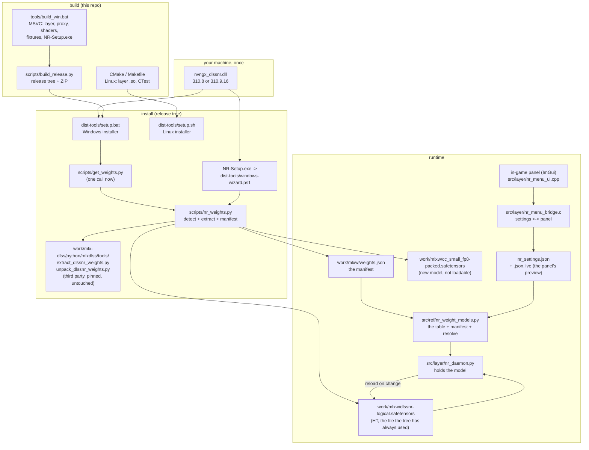

# Weights: which model a DLL carries, how it lands, and how it is switched

Everything about weight provenance in one place: what ships, what is detected, what an install can
run, and what happens when the panel or the settings file asks for a different model. The short
version is that **NVIDIA's DLL is never copied and never decoded by first-party code**: a
third-party extractor does that, this tree only decides *which* resource to hand it and *which file*
the daemon should load.

## 1. The two DLL generations

| | 310.8.0.0 (2026-08) | 310.9.16.0 (2026-09) |
| --- | --- | --- |
| file size | 165,840,496 | 266,424,944 |
| `WEIGHTS_HT` | 147,695,410 B, 153 packed tensors | **byte-identical** (same resource sha256) |
| `WEIGHTS_CC_SMALL_FP8` | — | **113,893,343 B, 77 packed tensors, 30 blocks** |
| `.text` | 699,904 | 873,472 |
| `.data` (kernel containers) | 17,180,672 | 3,672,576 |
| `.rsrc` | 147,697,152 | 261,590,528 |

`WEIGHTS_HT` is the model this project is built on: 153 packed tensors that unpack to 649 logical
ones (`dlssnr-logical.safetensors`). It is unchanged between the two versions - verified tensor by
tensor, and the resource blob itself has the same sha256 - so **a new DLL runs exactly like the old
one** and the project's own frame time and output do not move.

`WEIGHTS_CC_SMALL_FP8` is new and is a **different model**, not a precision variant: 30 blocks with
one layer each in places, against HT's 71 blocks at 32/64/128/256 wide. The unpacker's block
contracts are HT's, so this one is extracted and recorded but **cannot be loaded**. It is not hidden
by the tools: `--inspect` lists it, the manifest marks it `supported: false`, and a settings value
that names it falls back to HT with one line in the log.

## 2. Where the pieces are



The rule the picture encodes: **`nr_weight_models.py` is the only opinion about what exists.** The
installer writes the manifest, the daemon reads it, and the panel's settings key is resolved through
it. No second copy of "which model is this file" exists anywhere.

## 3. Detection, in one command

```
python scripts/nr_weights.py --inspect D:\nvngx_dlssnr.dll
```

walks the PE resource directory for `RCDATA` entries named `WEIGHTS*` and prints what it found. It
does not need the extractor, numpy, or a GPU: it is a header read. A `WEIGHTS_*` name this build does
not know is reported with `known: false` rather than ignored - a future version that renames the
resource has to read as "there is something here this build does not understand", never as "no
weights".

```
python scripts/nr_weights.py --extract D:\nvngx_dlssnr.dll --work-dir work
```

extracts **every** resource it found, in one run:

| resource | output | loadable |
| --- | --- | --- |
| `WEIGHTS_HT` | `work/mlxw/dlssnr-packed.safetensors` -> `work/mlxw/dlssnr-logical.safetensors` | yes |
| `WEIGHTS_CC_SMALL_FP8` | `work/mlxw/cc_small_fp8-packed.safetensors` | no (different block table) |

and writes `work/mlxw/weights.json`:

```json
{
  "format": "nr-weights-manifest-v1",
  "source": {"dll": "...", "sha256": "...", "bytes": 266424944, "resources": [...]},
  "models": [
    {"name": "ht", "resource": "WEIGHTS_HT", "logical": "dlssnr-logical.safetensors",
     "packed": "dlssnr-packed.safetensors", "supported": true, "expected_tensors": 649},
    {"name": "cc_small_fp8", "resource": "WEIGHTS_CC_SMALL_FP8",
     "logical": "dlssnr-cc-small-fp8-logical.safetensors", "supported": false,
     "note": "different block table; not loadable yet"}
  ],
  "default": "ht"
}
```

The extractor's own constant is not patched: `nr_weights.py` loads the pinned upstream module and
wraps `extract_pe_resource`, whose name is a *parameter* - `RESOURCE_NAME` is bound as a default
argument when the function is defined, so rebinding the constant changes nothing and every model
comes out as HT. That is recorded in the code because the first version of this did exactly that and
looked like it worked.

## 4. Compatibility, stated as fallbacks

| situation | what happens |
| --- | --- |
| DLL is 310.8 (one resource) | installs exactly as before: one packed file, one logical file, no second entry in the manifest |
| install predates the manifest | `nr_weight_models.available()` reports the single `dlssnr-logical.safetensors`; everything resolves as it always did |
| settings name a model the machine does not have | falls back to the supported model that is present, one line in the daemon log |
| settings name `cc_small_fp8` | daemon keeps HT and says `weights: cc_small_fp8 is not loadable here (ht is); keeping ht` |
| manifest in an unknown format | ignored, legacy path taken |
| `--skip-extract` | unchanged: unpacks `work/mlxw/dlssnr-packed.safetensors` if the logical file is missing |

## 5. Hot switching

The settings file gains one key, `weights`, naming a model. The daemon re-reads the settings file on
every frame anyway (that is how every other knob works), so the switch is:

```mermaid
sequenceDiagram
    participant P as panel (or an editor)
    participant F as nr_settings.json / .json.live
    participant D as nr_daemon
    participant G as device

    P->>F: weights = cc_small_fp8
    D->>F: refresh() (per frame)
    D->>D: nr_weight_models.resolve("cc_small_fp8")
    alt loadable and present
        D->>G: drop GPU image engine, close backend (weights unload)
        D->>D: ResidentBackend(other file)
        D-->>F: log "weights: ht -> other (...s)"
    else not loadable here
        D-->>F: log "... is not loadable here (ht is); keeping ht"
    end
    Note over D,G: next present is answered by the model now in memory
```

`refresh_model` in `nr_daemon.py` is the only writer of the daemon's model, it runs once per
accepted connection, and it acts only when the requested name differs from the one it last resolved -
so a repeated value costs nothing and an impossible one is explained once, not once a frame.

## 6. The panel row: what it needs, and what is in the way

The config and daemon halves are done; the panel half is a knob, and a knob in this tree is six
joined files. In order:

1. `src/layer/nr_knobs.py` - the knob's name, kind (`choice`), default and explanation.
2. `src/layer/nr_menu_bridge.c` - the same entry in `knobs[]`, with `ht,cc_small_fp8` as the choices.
3. `dist-tools/windows-wizard.ps1` - `Hint.weights` in all four languages (the panel's tooltip comes
   from the wizard's hint table, which is what keeps the installer and the overlay saying the same
   words).
4. `py tools/gen_menu_strings.py` - regenerate `nr_menu_strings.{c,h,py}`.
5. `py src/tools/knob_doc.py` - regenerate the README's knob table.
6. `py -m unittest` over `test_menu_rows`, `test_menu_hints`, `test_settings_live`,
   `test_windows_wizard`, and `knob_doc --check`.

Until that is done the settings key works when written by hand or by anything that writes the JSON,
and the panel simply has no row for it. Doing it half-way is worse than not doing it: the hint tables
are checked per knob for every language, so a knob that reaches one file and not the others turns the
suite red.

## 7. What is deliberately not here

- NVIDIA's DLL, any weight file derived from it, and any kernel of theirs: not in the tree, not in a
  release, not in this document. The manifest records the sha256 of the DLL a user extracted from,
  which is provenance, not content.
- The FP8 model's loader. It needs its own block contracts and a dequantisation path; until then the
  manifest's `supported: false` is the honest answer, and the panel will show it as unavailable
  rather than offering a choice that cannot work.
- Any second GPU vendor or Linux weight path. This project is Intel/Windows; the Linux build reads
  the same manifest and the same HT file, so nothing here is Windows-only in principle.
